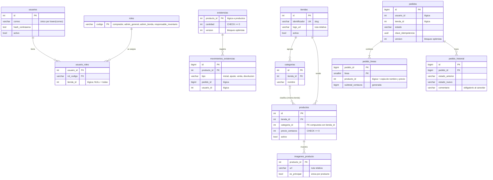

# ADR 0013: Migraciones con Alembic y esquema relacional de los cuatro módulos

- **Estado:** Propuesta — pendiente de revisión y ratificación del equipo
- **Fecha:** 2026-10-22
- **Relacionada:** [ADR 0001](0001-monolito-modular.md) (dueño único de datos,
  una sola PostgreSQL), [ADR 0008](0008-separar-catalogo-inventario.md)
  (referencia lógica `producto_id`), [ADR 0010](0010-no-extraer-modulos.md),
  [ADR 0014](0014-seguridad-rls.md) (RLS sobre este esquema) y la deuda V6 de
  [`violaciones-s6.md`](../violaciones-s6.md).

## Contexto

Hasta la API `0.3.0` el esquema lo creaba `Base.metadata.create_all` al
arrancar la API, y el catálogo se sembraba en el mismo `lifespan`. Solo
existían `catalog_products` e `inventory_stock`; identidad y pedidos no tenían
tablas. Los cambios de esquema se resolvían con SQL manual
(`backend/migrations/0001_move_stock_to_inventory.sql`). La auditoría S6 lo
registró como deuda V6.

`create_all` no altera tablas existentes, no deja historia, no se puede
revertir y hace que cada réplica de la API toque el esquema. Además las
pruebas corrían sobre SQLite en memoria, que no verifica `CHECK` complejos,
índices parciales, columnas generadas, `NULLS NOT DISTINCT` ni RLS, y la API
caía silenciosamente a SQLite si faltaba configuración.

El frontend necesita ya cinco tiendas, categorías, imágenes, cuentas con roles
y pedidos con historial ([`tiendas-catalogo.md`](../api/tiendas-catalogo.md),
[`idempotencia-saga-s11.md`](../idempotencia-saga-s11.md),
[`modos-fallo-s11.md`](../modos-fallo-s11.md)).

## Alternativas consideradas

1. **Seguir con `create_all` y SQL manual.** Sin dependencias nuevas, pero
   mantiene V6 y no sirve para cambios destructivos. Rechazada.
2. **Migraciones SQL numeradas con un ejecutor propio.** Control total, pero
   habría que reinventar el registro de versiones y la comparación con los
   modelos. Rechazada.
3. **Alembic con migraciones escritas a mano y verificadas contra los
   modelos.** Herramienta estándar de SQLAlchemy; `alembic check` y
   `compare_metadata` detectan divergencias. Seleccionada.

## Decisión

### Alembic

- `backend/alembic.ini`, `backend/alembic/env.py` y `backend/alembic/versions/`.
  `env.py` es un composition root: importa los `models.py` de los cuatro
  módulos y usa `target_metadata = Base.metadata` con `compare_type=True`.
- La URL nunca está en `alembic.ini`: sale de
  `resolve_database_url(migraciones=True)` (credenciales del rol dueño, ver
  ADR 0014).
- `Base.metadata` tiene `naming_convention` (`pk_`, `fk_`, `uq_`, `ck_`,
  `ix_`): los nombres de restricciones son deterministas y las migraciones los
  fijan con `op.f()`.
- La primera migración, `0001_esquema_inicial`, está escrita a mano, borra
  `catalog_products` e `inventory_stock` (`DROP TABLE IF EXISTS`) y crea el
  esquema completo con los roles de referencia. Sus datos se exportan antes con
  `backend/scripts/exportar_datos_legado.py` y se pueden recargar con
  `python -m app.seed --desde-json`. La migración SQL manual anterior se
  elimina: queda sustituida y su historia está en Git y en el ADR 0008.
- En despliegue, un servicio de una sola ejecución `migrate` (misma imagen,
  `alembic upgrade head`) corre antes de la API; la API depende de él con
  `service_completed_successfully`. La API ya no crea tablas ni siembra datos.
- La siembra de demostración es un comando explícito e idempotente,
  `python -m app.seed`, que usa solo funciones públicas (`public.py`) de
  Catálogo e Inventario. No crea usuarios ni contraseñas.

### Esquema

Tablas en español, cada una propiedad de su módulo y declarada en su
`models.py`:

| Módulo | Tablas |
|---|---|
| `identity` | `usuarios`, `roles`, `usuario_roles` |
| `catalog` | `tiendas`, `categorias`, `productos`, `imagenes_producto` |
| `inventory` | `existencias`, `movimientos_existencias` |
| `orders` | `pedidos`, `pedido_lineas`, `pedido_historial` |

> _Fig. 1 — Modelo entidad-relación. Las líneas son claves foráneas, todas
> dentro de un mismo módulo. Las referencias entre módulos (`producto_id`,
> `usuario_id`, `tienda_id`, `pedido_id`) son enteros sin FK ni `relationship()`._

Reglas que fija el esquema:

- **Referencias lógicas entre módulos.** Ninguna FK ni relación ORM cruza un
  módulo (ADR 0001 y 0008); la prueba de arquitectura sigue impidiendo imports
  de internos ajenos.
- **Un pedido pertenece a una sola tienda.** El checkout divide el carrito por
  tienda; `UNIQUE (usuario_id, clave_idempotencia, tienda_id)` permite reutilizar
  la misma `Idempotency-Key` para los pedidos hermanos de un mismo intento.
- **Historial de pedidos** (`pedido_historial`) para trazabilidad y métricas
  (tiempo entre estados, cancelaciones por tienda); cancelar exige comentario.
- **Copias en las líneas** (`producto_nombre`, `precio_unitario_centavos`):
  el pedido no cambia si el catálogo cambia; el subtotal es una columna generada.
- **Bloqueo optimista** (F-03) con `version_id_col` en `existencias` y `pedidos`;
  cada cambio de stock deja un `movimiento_existencias`.
- **Imágenes como rutas relativas** (`/media/productos/15/frente.webp`), sin
  binarios en la base; a lo sumo una principal por producto (índice parcial).
- **Categoría de la misma tienda** mediante la FK compuesta
  `(categoria_id, tienda_id) → categorias(id, tienda_id)` (MATCH SIMPLE: la
  categoría es opcional).
- Los valores de estado y tipo de movimiento viven en tuplas del módulo
  (`ESTADOS_PEDIDO`, `TIPOS_MOVIMIENTO`) y los `CHECK` de los modelos se
  construyen desde ellas; la migración guarda una copia literal.

### Configuración y pruebas

- `shared/database.py` falla con `ConfiguracionBaseDatosError` si no hay
  `DATABASE_URL` ni `DB_HOST`: se elimina el respaldo silencioso a SQLite.
- Las pruebas usan PostgreSQL real (`DATABASE_URL` obligatoria, base con
  `test` en el nombre), aplican `alembic upgrade head` una vez por sesión y
  vacían los datos entre pruebas conservando `roles`. Incluyen restricciones,
  bloqueo optimista, `upgrade → downgrade base → upgrade` y la comparación de
  modelos contra la base (`compare_metadata`, equivalente a `alembic check`).
  CI levanta `postgres:17-alpine` como servicio.

## Consecuencias

- Se cierra la deuda V6: el esquema tiene historia, es reversible y se verifica.
- **Ruptura de datos controlada:** `0001_esquema_inicial` elimina las tablas
  anteriores. Antes de aplicarla en un entorno con datos hay que exportarlos.
- El contrato HTTP se conserva: `GET /catalog/products` y `GET /inventory`
  mantienen sus campos; `ProductOut` gana `tienda` e `imagen_url` opcionales
  (API `0.3.1`, cambio compatible según el ADR 0002).
- Un despliegue ya no arranca con catálogo: hay que ejecutar la siembra.
- Ejecutar las pruebas requiere un PostgreSQL (contenedor local o servicio de CI).
- Los `CHECK` no los compara `alembic check`; un cambio de estados exige una
  migración nueva además de cambiar la tupla del módulo.

## Revisión humana pendiente

El equipo debe ratificar o rechazar esta propuesta y cambiar su estado.
