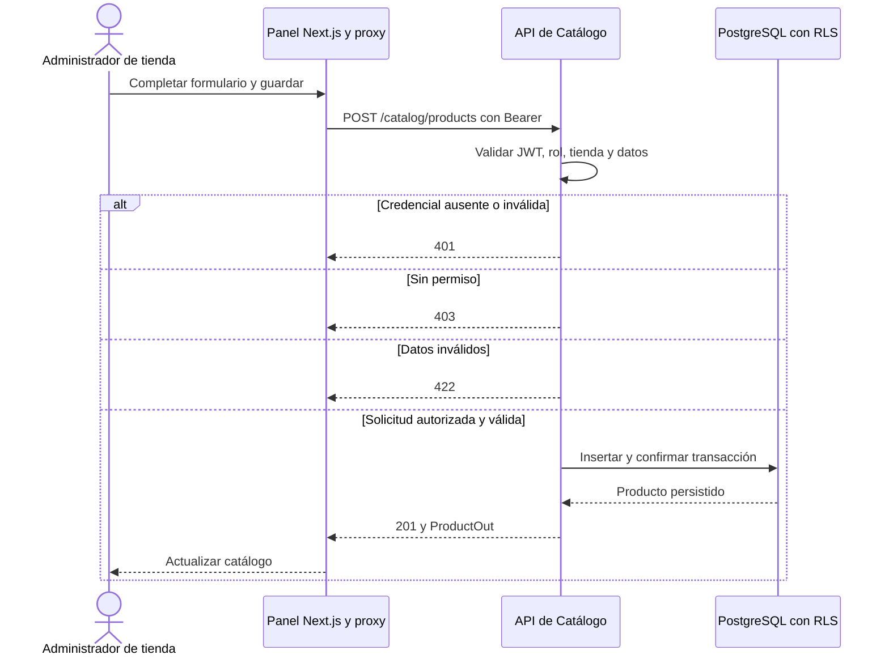

# Administración de la tienda y gestión del catálogo

**Estado al 2026-11-22:** implementado desde la API 0.4.0. En la API 0.5.0 escribe el administrador de la tienda correspondiente; el general solo supervisa ([ADR 0017](../adr/0017-admin-general-supervisa.md)). Esta actualización reemplaza la descripción del diseño original de S7 por el comportamiento entregado.

## Actores y responsabilidades

| Actor | Capacidad |
|---|---|
| Visitante o comprador | Consultar productos activos y disponibilidad. |
| Administrador de tienda | Crear, editar, activar y desactivar productos propios; gestionar stock y pedidos de su tienda. |
| Responsable de inventario | Consultar y ajustar existencias, atender pedidos de su tienda; no modificar precios. |
| Administrador general | Supervisar todas las tiendas, incluidos productos inactivos; no escribir productos, stock ni pedidos. |

La administración de productos se realiza en `/admin`, mediante [PanelAdmin](../../frontend/components/admin/PanelAdmin.tsx) y [FormProducto](../../frontend/components/admin/FormProducto.tsx). La API valida permisos en cada operación y PostgreSQL aplica RLS. No se requiere acceso directo a la base para crear o editar un producto.

## Flujo implementado

El navegador usa `/api/proxy/catalog/products`; el proxy reenvía a `/catalog/products` de la API interna. Una tienda inexistente produce 404 y un nombre repetido en la misma tienda produce 409. Editar aplica el mismo control de permisos y devuelve 200 tras confirmar la transacción.

## Contrato disponible

| Operación | Entrada o filtro | Resultado |
|---|---|---|
| `GET /catalog/products` | `incluir_inactivos=true` para los inactivos visibles al rol. | Lista `ProductOut`; el público solo ve activos de tiendas activas. |
| `GET /catalog/products/{productId}` | ID de producto. | 200 o 404 si no existe o no es visible. |
| `GET /catalog/tiendas` | Sin parámetros. | Tiendas activas. |
| `POST /catalog/products` | `tienda`, `nombre`, `precio_centavos`; opcionales `descripcion`, `categoria`, `presentacion`, `precio_confirmado`, `activo`. | 201 y producto. |
| `PATCH /catalog/products/{productId}` | Campos editables; no permite cambiar ID, tienda ni existencias. | 200 y producto actualizado. |

Los [esquemas](../../backend/app/modules/catalog/schemas.py) rechazan campos adicionales, nombres vacíos y precios negativos. Los [routers](../../backend/app/modules/catalog/router.py) documentan errores y permisos; [OpenAPI](openapi.json) es el contrato ejecutable versionado.

## Activación y existencias

`activo` existe en el modelo y el contrato. Un producto activo sin unidades puede mostrarse agotado; uno inactivo no aparece al público y solo lo consultan los roles autorizados.

Inventario posee `existencias` y `movimientos_existencias`. Crear un producto no carga unidades: se ajustan mediante [Inventario](../../backend/app/modules/inventory/router.py). `inventory_stock` era la tabla anterior a Alembic.

## Verificación y límites

- [Pruebas de catálogo administrativo](../../backend/tests/test_catalog_admin.py): creación, edición, validación y permisos.
- [Pruebas por tienda](../../backend/tests/test_admin_por_tienda.py), [RLS](../../backend/tests/test_rls.py) y [contrato](../../backend/tests/contract/test_openapi.py).
- [E2E históricas](../pruebas-e2e-testsprite.md) y [condiciones de cierre](../cierre-proyecto.md).

La asignación de roles y el cambio de contraseña desde la interfaz siguen pendientes; no forman parte de la administración de productos ya entregada.
