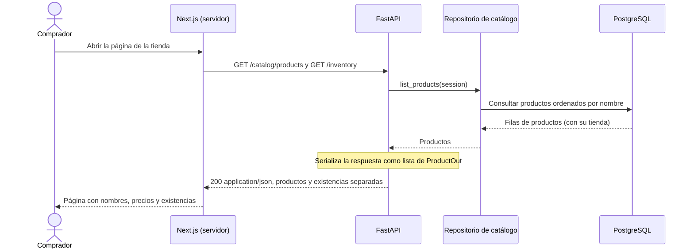
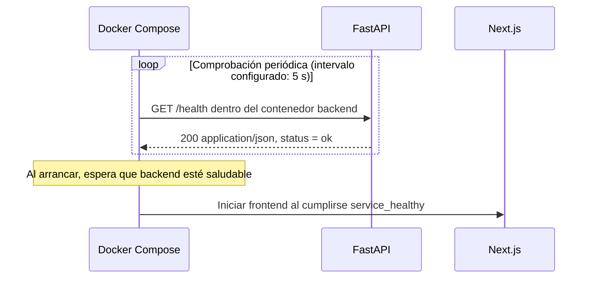

# Contrato de la API de Tienda Virtual UTB

Esta guía explica el [contrato OpenAPI guardado](openapi.json) y su relación con
la implementación. La decisión de integración está en el
[ADR 0002](../adr/0002-contrato-integracion-http.md); los comandos de pruebas y
actualización están en la [guía de evidencia](README.md).

## 1. Alcance y acceso

| Aspecto | Valor actual |
|---|---|
| Versión de la API (`info.version`) | `0.5.0` |
| Versión del formato de especificación (`openapi`) | `3.1.0` |
| Comunicación | HTTP síncrono, respuestas JSON |
| Dirección local con Docker Compose | `http://localhost:8000` |
| Dirección usada por Next.js dentro de Compose | `http://backend:8000` |
| Autenticación | Las consultas del catálogo, el inventario y la salud son públicas. Identidad, pedidos y escrituras usan `Authorization: Bearer <JWT>` (esquema `bearerAuth`, [ADR 0016](../adr/0016-autenticacion-jwt.md)). |
| Documentación interactiva con la API encendida | `http://localhost:8000/docs` |
| Especificación generada por la aplicación encendida | `http://localhost:8000/openapi.json` |

`0.5.0` identifica la versión de nuestra API; `3.1.0` identifica el formato
OpenAPI utilizado para describirla. Las direcciones anteriores corresponden
al entorno local; el contrato no declara una sección `servers`.

Un **endpoint** es una operación accesible mediante un método HTTP y una ruta.
`GET` indica una consulta; `POST`, `PUT` y `PATCH`, cambios. La sección 5
resume las 20 operaciones; esta guía detalla las de consulta y operación.

## 2. Diagrama de la consulta del catálogo

Este flujo corresponde al comprador que consulta productos. El administrador
de la tienda tiene un [flujo de gestión propio](administracion-catalogo.md)
para registrar productos nuevos, editar sus datos y habilitar su venta.

> **Ilustración histórica:** [imagen previa a la separación 0.3.0](images/consulta-catalogo-presentacion.png)
> todavía muestra `existencias` dentro de `ProductOut`; el contrato actual está
> descrito por este flujo y por OpenAPI, donde `GET /inventory` expone ese dato.



El diagrama representa el caso exitoso en Docker Compose. Next.js realiza la
consulta desde el servidor, sin caché, en cada petición
(`frontend/lib/catalogo-servidor.ts`), compone catálogo e inventario
([ADR 0008](../adr/0008-separar-catalogo-inventario.md)) y renderiza la página. Si la
consulta falla, la vista muestra la carta guardada en el frontend con un aviso
visible y deja apartar en pausa. Las pruebas del
backend usan PostgreSQL con el esquema aplicado por Alembic (ADR 0013).

## 3. Consultar productos: `GET /catalog/products`

**Propósito:** obtener el catálogo a la venta (productos activos de tiendas
activas), ordenado por `nombre`. Con `?incluir_inactivos=true`, quien gestiona
una tienda recibe también los inactivos de las suyas. No hay paginación.

Petición de ejemplo desde PowerShell:

```powershell
Invoke-RestMethod -Uri 'http://localhost:8000/catalog/products' -Method Get
```

**Respuesta documentada:** código HTTP `200` y `Content-Type: application/json`.
El cuerpo es un arreglo de objetos `ProductOut`. Este ejemplo muestra un solo
producto; los datos y la cantidad de productos pueden variar:

```json
[
  {
    "id": 1,
    "nombre": "Café americano",
    "descripcion": "Vaso de 8 oz",
    "precio_centavos": 350000,
    "tienda": "alegria",
    "imagen_url": null,
    "categoria": "Bebidas",
    "presentacion": null,
    "precio_confirmado": false,
    "activo": true
  }
]
```

### Campos de `ProductOut`

| Campo | Tipo en OpenAPI | Obligatorio | Significado |
|---|---|---|---|
| `id` | `integer` | Sí | Identificador del producto. |
| `nombre` | `string` | Sí | Nombre mostrado en el catálogo. |
| `descripcion` | `string` | Sí | Descripción del producto. |
| `precio_centavos` | `integer` | Sí | Precio en centavos de COP, según la interpretación del frontend. `350000` equivale a 3500 pesos. |
| `tienda` | `string` o `null` | No | Identificador (slug) de la tienda: `antojos`, `punto-fit`, `alegria`, `almuerzo-01`, `almuerzo-02`. |
| `imagen_url` | `string` o `null` | No | Imagen del producto, si existe. |
| `categoria` | `string` o `null` | No | Nombre de la categoría dentro de su tienda. |
| `presentacion` | `string` o `null` | No | «Entero», «Medio», «Bolsa»… El nombre es único por tienda, así que las variantes lo repiten entre paréntesis. |
| `precio_confirmado` | `boolean` | No | `false` = precio de referencia que la tienda aún no confirmó. |
| `activo` | `boolean` | No | Si el producto está a la venta. |

El contrato exige los cuatro primeros campos y no admite `null` en ellos. Las
existencias se consultan por separado en `GET /inventory`, cuyo contrato es
`{product_id, existencias}`. Actualmente
no fija valores mínimos, longitudes de texto ni una cantidad mínima de productos;
por tanto, `[]` es una respuesta válida. Tampoco prohíbe propiedades adicionales.
El orden por nombre y la interpretación monetaria son comportamientos del código
actual, no restricciones expresadas por el esquema OpenAPI.

Ejemplos de incumplimiento: omitir `nombre`, enviar `precio_centavos` como
`"350000"` (texto) o devolver un objeto en lugar del arreglo.

## 4. Comprobar la API: `GET /health`

**Propósito:** comprobar que el proceso de FastAPI puede atender esta petición
HTTP. Es una comprobación básica de funcionamiento, también llamada *liveness*.

- **`GET`:** método HTTP para consultar.
- **`/health`:** ruta elegida para consultar el estado del proceso; *health*
  significa «salud».
- **`200`:** la petición se atendió correctamente.
- **`{"status":"ok"}`:** cuerpo que devuelve la función de salud.

Petición de ejemplo desde PowerShell:

```powershell
Invoke-RestMethod -Uri 'http://localhost:8000/health' -Method Get
```

Respuesta documentada: `200 application/json`.

```json
{
  "status": "ok"
}
```

| Campo | Tipo | Obligatorio | Restricción |
|---|---|---|---|
| `status` | `string` | Sí | Debe ser exactamente `"ok"`, declarado mediante `const` en `HealthOut`. |

### Uso real en Docker Compose



En [`compose.yaml`](../../compose.yaml), el chequeo tiene un intervalo de
5 segundos, un tiempo límite de 5 segundos y 10 intentos fallidos antes de
considerar el contenedor no saludable. El comando usa `urllib.request.urlopen`:
comprueba que la petición termine sin error; no valida el cuerpo JSON.
Las pruebas de contrato sí comprueban ese cuerpo.

### Qué permite concluir y qué queda fuera

Una respuesta correcta confirma que se pudo contactar la API y ejecutar esa
función. La función no consulta la base de datos ni comprueba catálogo, frontend
o servicios externos. Por ejemplo, si PostgreSQL deja de responder después del
arranque, `/health` podría seguir devolviendo `200` mientras la consulta del
catálogo falla. Durante el arranque, en cambio, la aplicación sí necesita
preparar las tablas y los datos antes de atender solicitudes.

Una comprobación de **preparación para atender operaciones** (*readiness*)
incluye las dependencias necesarias: es `GET /health/ready` (sección 4.1).
El chequeo de Compose tampoco reinicia automáticamente el backend ni garantiza la
disponibilidad permanente del sistema; la dependencia del frontend en Compose
se usa para ordenar su arranque.

### 4.1 Readiness: `GET /health/ready`

A diferencia de `/health` (liveness), esta operación ejecuta `SELECT 1` contra
la base de datos y responde `503` si no responde:

```json
{ "status": "ok", "detalle": null }
```

| Campo | Tipo | Obligatorio | Restricción |
|---|---|---|---|
| `status` | `string` | Sí | `"ok"` o `"error"` |
| `detalle` | `string` o `null` | Sí | Motivo del fallo cuando `status` es `"error"` |

## 4.2 Métricas consultables: `GET /metrics`

Devuelve el resumen en memoria del middleware de observabilidad: tiempo de
proceso activo (`uptime_segundos`), el escenario asociado y, por ruta, el
conteo de peticiones, errores 5xx y latencias (promedio, p50, p95, máximo) en
milisegundos. Es la métrica ligada al escenario 4 (disponibilidad bajo
consultas concurrentes); las muestras viven en el proceso y se reinician con
él. Ejemplo recortado:

```json
{
  "uptime_segundos": 12.4,
  "escenario_asociado": "disponibilidad — ~5 consultas concurrentes al catálogo",
  "rutas": {
    "GET /catalog/products": {
      "peticiones": 3,
      "errores_5xx": 0,
      "latencia_ms": { "promedio": 2.8, "p50": 2.8, "p95": 3.1, "max": 3.4 }
    }
  }
}
```

## 5. Operaciones, errores y límites del contrato

| Módulo | Operaciones | Acceso |
|---|---|---|
| Operación | `GET /health`, `GET /health/ready`, `GET /metrics` | Público |
| Identidad | `POST /identity/register`, `POST /identity/login`, `GET /identity/me` | Público / `bearerAuth` en `me` |
| Catálogo | `GET /catalog/products`, `GET /catalog/products/{productId}`, `GET /catalog/tiendas` | Público |
| Catálogo | `POST /catalog/products`, `PATCH /catalog/products/{productId}` | `admin_tienda` de la tienda (el `admin_general` solo supervisa: 403) |
| Inventario | `GET /inventory` | Público |
| Inventario | `GET /inventory/{productId}` | Cualquier cuenta (`bearerAuth`) |
| Inventario | `PUT /inventory/{productId}`, `POST /inventory/{productId}/adjust` | `responsable_inventario` o `admin_tienda` de la tienda (el `admin_general`: 403) |
| Pedidos | `GET /orders`, `POST /orders`, `GET /orders/{orderId}`, `POST /orders/{orderId}/cancel` | Cuenta propia; con `?tienda_id=` la cola de la tienda para quien la supervisa |
| Pedidos | `POST /orders/{orderId}/estado` | Quien gestiona la tienda del pedido |

### 5.1 Matriz de permisos por rol (API 0.5.0, [ADR 0017](../adr/0017-admin-general-supervisa.md))

«Tienda A» es la tienda dueña del recurso. El admin de la tienda B es un
`admin_tienda` de **otra** tienda. La misma regla se aplica en la base con RLS
([ADR 0014](../adr/0014-seguridad-rls.md)), así que un error en la API no la
salta.

| Operación | Anónimo | Comprador | Admin de A | Responsable de inventario de A | Admin de B | `admin_general` |
|---|---|---|---|---|---|---|
| Catálogo, tiendas, `GET /inventory`, salud | 200 | 200 | 200 | 200 | 200 | 200 |
| `GET /catalog/products?incluir_inactivos=true` | solo activos | solo activos | + inactivos de A | + inactivos de A | + inactivos de B | + inactivos de todas |
| `GET /catalog/products/{id}` de un producto inactivo de A | 404 | 404 | 200 | 200 | 404 | 200 |
| `POST /catalog/products` en A, `PATCH` de un producto de A | 401 | 403 | 201 / 200 | 403 | 403 | **403** |
| `PUT /inventory/{id}`, `POST /inventory/{id}/adjust` de A | 401 | 403 | 200 | 200 | 403 | **403** |
| `GET /orders?tienda_id=A` (cola) | 401 | 403 | 200 | 200 | 403 | 200 (solo lectura) |
| `GET /orders/{id}` de un pedido de A | 401 | 200 si es suyo, si no 404 | 200 | 200 | 404 | 200 |
| `POST /orders/{id}/estado` de A | 401 | 404 (403 si es suyo) | 200 | 200 | 404 | **403** |
| `POST /orders/{id}/cancel` de A | 401 | 200 si es suyo y está por pagar | 200 | 200 | 404 | **403** |

- Al `admin_general` el 403 le responde siempre con el mismo detalle:
  «El administrador general solo supervisa: los cambios los hace el admin de la
  tienda» (`SOLO_SUPERVISA` en `app/shared/seguridad.py`).
- Al admin de B un pedido de A le responde 404: no lo ve y la API no revela que
  existe. Los productos sí son públicos, por eso sus escrituras responden 403.
- El `admin_general` sigue gestionando cuentas, roles y tiendas (políticas de
  `usuarios`, `usuario_roles` y `tiendas`), aunque esas operaciones aún no
  tienen endpoint.
- Las tareas programadas (`python -m app.tareas.vencer_pedidos`) actúan como el
  principal **sistema** (`app.es_sistema`), que no se puede obtener desde la API.

Los errores usan el cuerpo `{"detail": "..."}` (`ErrorResponse`): `401` sin
credencial válida (con `WWW-Authenticate: Bearer`), `403` si el rol no
alcanza, `404` si el recurso no existe o no es visible, `409` ante un
conflicto (correo duplicado, nombre repetido en la tienda o cambio
concurrente detectado por bloqueo optimista) y `400` por reglas de negocio
(sin existencias, transición de estado inválida, llave de idempotencia
vencida). La validación de datos responde `422` con el formato de FastAPI.

`POST /orders` exige la cabecera `Idempotency-Key` (UUID) y responde una lista
de pedidos, uno por tienda: `201` si los creó y `200` si la llave ya se había
usado ([diseño e implementación](../idempotencia-saga-s11.md)). Las `notas`
por ítem no forman parte del contrato (aplazadas con la reapertura del
[ADR 0011](../adr/0011-sesion-localstorage.md)).

El contrato de diseño del frontend
([`../openapi/tienda-virtual.yaml`](../openapi/tienda-virtual.yaml)) describe
las mismas 20 operaciones; de él se generan los tipos de
`frontend/lib/api/generated/contract.ts`.

## 6. Cómo se mantiene el acuerdo

El archivo `openapi.json` es la referencia guardada para revisión y control de
versiones. Las pruebas verifican su validez, su igualdad con la especificación
generada por FastAPI y las respuestas HTTP de cada operación contra su
esquema (`backend/tests/contract/test_openapi.py`). Dos casos negativos
demuestran que el esquema rechaza la ausencia de `nombre` y un precio como texto.

GitHub Actions ejecuta esas pruebas en cada `push` y `pull_request`; un
incumplimiento hace fallar el paso. El equipo debe revisar compatibilidad y
actualizar explícitamente el contrato según el [ADR 0002](../adr/0002-contrato-integracion-http.md).
La guía es explicativa: ante un cambio deben revisarse juntos código, contrato,
pruebas y este documento.
