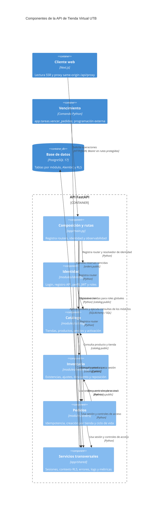

# C4 nivel 3 de componentes de la API

**Fecha de revisión:** 2026-11-22. **Sistema:** Tienda Virtual UTB. **Contenedor ampliado:** API FastAPI del [nivel 2](container.md). **Notación:** Mermaid `C4Component`.

Los componentes son módulos del mismo proceso. Las flechas entre ellos representan llamadas Python a contratos públicos; no representan microservicios ni un bus de eventos. La API mantiene una sesión transaccional compartida para crear un pedido y reducir stock ([ADR 0018](../adr/0018-transaccion-compartida-pedidos-inventario.md)).

| Componente | Ubicación | Responsabilidad y prueba |
|---|---|---|
| Composición | [main.py](../../backend/app/main.py) | Monta la API y el resolvedor de identidad; [salud](../../backend/tests/test_health.py) y [observabilidad](../../backend/tests/test_observability.py). |
| Identidad | [router](../../backend/app/modules/identity/router.py), [public](../../backend/app/modules/identity/public.py) | Autentica y resuelve roles actuales; [pruebas](../../backend/tests/test_identity.py). |
| Catálogo | [router](../../backend/app/modules/catalog/router.py), [public](../../backend/app/modules/catalog/public.py) | Lee y administra metadatos de productos; [pruebas](../../backend/tests/test_catalog_admin.py). |
| Inventario | [router](../../backend/app/modules/inventory/router.py), [public](../../backend/app/modules/inventory/public.py) | Posee `existencias` y `movimientos_existencias`; [pruebas](../../backend/tests/test_inventory_escrituras.py). |
| Pedidos | [router](../../backend/app/modules/orders/router.py), [service](../../backend/app/modules/orders/service.py), [public](../../backend/app/modules/orders/public.py) | Coordina creación, estados, cancelación y vencimiento; [pruebas](../../backend/tests/test_orders.py). |
| Transversales | [database](../../backend/app/shared/database.py), [seguridad](../../backend/app/shared/seguridad.py) | Proporciona sesiones y contexto por transacción, sin poseer datos de negocio; [RLS](../../backend/tests/test_rls.py). |
| Tarea de vencimiento | [vencer_pedidos](../../backend/app/tareas/vencer_pedidos.py) | Ejecuta compensaciones como principal sistema. Existe el comando; verificar su Schedule en Dokploy. |

Cada módulo agrupa router, esquemas, repositorio y modelos; Pedidos añade un servicio para coordinar el caso de uso. La [prueba de arquitectura](../../backend/tests/test_architecture.py) impide imports estáticos de internos de otro módulo. No verifica imports dinámicos ni SQL arbitrario. La estructura interna de Catálogo también se detalla en [arc42](../arc42/arc42-template-EN.md).
