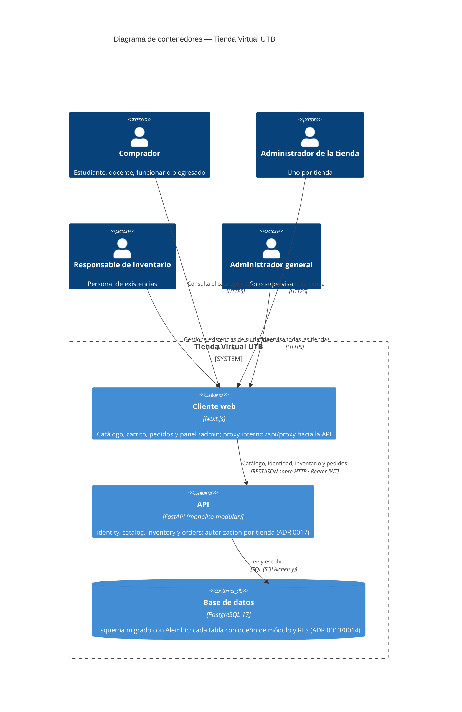

# C4 — Contenedores (Nivel 2)

> **Tipo:** diagrama de contenedores (C4 nivel 2). **Autor:** Equipo Tienda
> Virtual UTB. **Fecha:** 2026-08-31. **Notación:** C4 model
> (<https://c4model.com>), renderizado con Mermaid `C4Container`.
> **Trazabilidad:** `docs/adr/0001-monolito-modular.md` e historial de git.

Unidades desplegables de la Tienda Virtual UTB y su comunicación. Se
corresponden una a una con los servicios de `compose.yaml`. En esta fase no hay
sistemas externos (sin pasarela de pago ni SSO institucional; ver
`docs/c4/context.md` y la sección *Architecture Constraints* de
`docs/arc42/arc42-template-EN.md`).

## Notas

- **Leyenda.** `Person` = rol humano. `Container` = unidad desplegable/ejecutable
  por separado (no un contenedor Docker necesariamente); `ContainerDb` = almacén
  de datos. Cada flecha es una relación unidireccional etiquetada con propósito y
  protocolo. Desde la API 0.4.0 todos los flujos de
  los roles están implementados; desde la 0.5.0 cada admin de tienda solo
  escribe en la suya y el administrador general solo lee (ADR 0017).
- **Alcance del diagrama.** Solo unidades desplegables y su comunicación; la
  estructura interna de la API (componentes) se documenta en arc42 (*Building
  Block View, Level 2*), no aquí.
- **Cliente web (Next.js, :3000).** Componentes de servidor; la petición al
  catálogo se hace desde el servidor de Next.js hacia la API (`API_URL`), no
  desde el navegador.
- **API (FastAPI, :8000).** Un único proceso. No crea el esquema ni siembra al
  arrancar: lo hacen los servicios de una sola ejecución `migrate` (Alembic) y
  `seed` (opcional, `SEED_ON_DEPLOY=true`) ([ADR 0013](../adr/0013-migraciones-alembic-y-esquema.md)).
  `catalog` e `inventory` implementan lectura mediante contratos separados.
- **Base de datos (PostgreSQL, :5432 interno).** Instancia única con un volumen
  `postgres_data` que conserva los datos entre reinicios.
- El nivel 3 (componentes de la API) se documenta como *Building Block View,
  Level 2* en `docs/arc42/arc42-template-EN.md`.
- **Despliegue público:** Dokploy ejecuta las mismas tres unidades desde
  `deploy/compose.lab.yaml`. Solo el cliente web recibe un dominio; API y base
  permanecen en la red interna. La decisión está en el
  [ADR 0007](../adr/0007-despliegue-dokploy.md).
