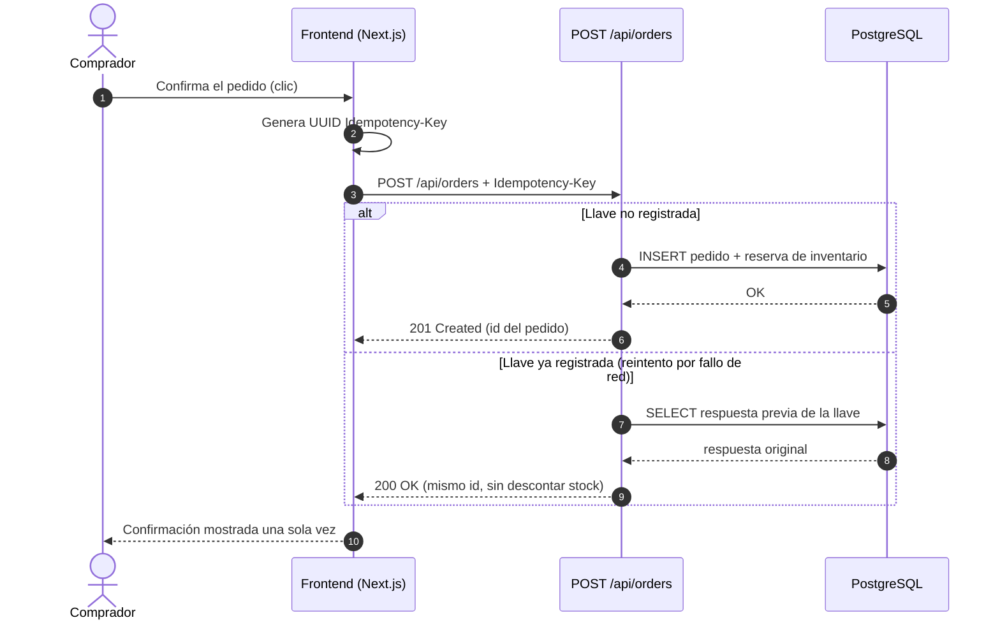
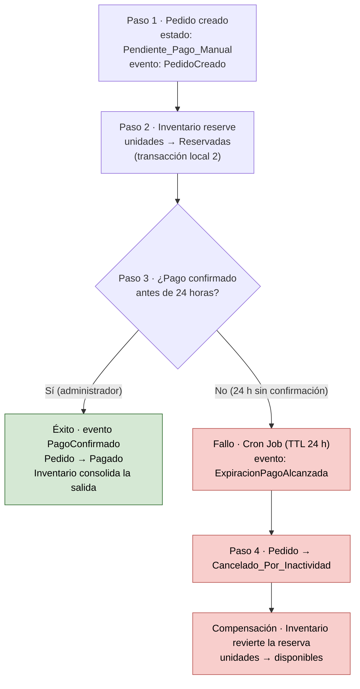

# Diseño de Idempotencia y Saga

> **Tipo:** evidencia S11 — diseño de idempotencia y saga. **Autor:** Equipo
> Tienda Virtual UTB. **Fecha:** 2026-10-18. **Estado:** documento de diseño;
> el endpoint `POST /api/orders` y la mensajería aún no existen en el código.
> **Trazabilidad:** [modos de fallo](modos-fallo-s11.md) (F-01, F-03, F-04),
> [`ADR 0001`](adr/0001-monolito-modular.md),
> [`ADR 0010`](adr/0010-no-extraer-modulos.md).

Dadas las restricciones actuales del sistema (pagos gestionados fuera de línea
y coordinación manual), se han diseñado los siguientes patrones para garantizar
la consistencia de los datos en el flujo principal de creación de pedidos.

## 1. Diseño de Idempotencia en la Creación de Pedidos

Para evitar la duplicación de pedidos y el doble descuento de inventario
debido a fallos de red o reintentos del usuario en el frontend, se implementa un
mecanismo de idempotencia en el endpoint de creación de pedidos
(`POST /api/orders`).

*   **Mecanismo:** El cliente (Frontend) genera un identificador único (UUID)
    llamado `Idempotency-Key` y lo envía en los *headers* de la petición HTTP.
*   **Flujo en el Backend:**
    1. El sistema recibe la petición y consulta si el `Idempotency-Key` ya
       existe en la base de datos o en una caché (ej. Redis) asociado a esa
       cuenta de usuario.
    2. **Si no existe:** Procesa el pedido, reserva el inventario, guarda el
       resultado con la llave de idempotencia y retorna `201 Created`.
    3. **Si ya existe:** El sistema intercepta la petición antes de ejecutar la
       lógica de negocio, recupera el estado de la respuesta anterior (ej. el ID
       del pedido ya creado) y retorna `200 OK` con los datos originales. No se
       vuelve a alterar el inventario ni se crea un registro duplicado.

**Reglas de diseño asociadas:**

- La llave se compone con la cuenta de usuario: un `Idempotency-Key` reutilizado
  por otra cuenta no puede devolver la respuesta de la primera.
- La respuesta original se conserva con un vencimiento acotado (mismo horizonte
  que el TTL de pago, 24 horas), tras el cual la llave deja de estar vigente.
- El modo de fallo que cubre es el **F-04** de la
  [tabla de modos de fallo](modos-fallo-s11.md); el bloqueo optimista (**F-03**)
  sigue siendo la salvaguarda dentro de la transacción, ya que dos llaves
  distintas sí pueden competir por la última unidad.

## 2. Diseño de Saga (Coreografía) para Gestión de Inventario y Pagos Manuales

Dado que un pedido involucra múltiples dominios (Pedidos e Inventario) y existe
un retraso asíncrono e incierto para la confirmación del pago manual, se define
una **Saga** para manejar la transacción a largo plazo y sus compensaciones.

*   **Paso 1 (Transacción Local 1 - Pedidos):** Se crea el registro del Pedido
    con estado `Pendiente_Pago_Manual`. Se emite el evento `PedidoCreado`.
*   **Paso 2 (Transacción Local 2 - Inventario):** El módulo de inventario
    escucha el evento, descuenta temporalmente las unidades disponibles y las
    marca como `Reservadas`.
*   **Paso 3 (Punto de Decisión / Espera):**
    *   **Escenario de Éxito:** Si el administrador confirma el pago en el
        sistema antes del tiempo límite, se emite `PagoConfirmado`. El Pedido
        pasa a estado `Pagado` y el Inventario consolida la salida de los
        productos.
    *   **Escenario de Fallo (Transacción Compensatoria):** Si transcurren 24
        horas sin confirmación de pago (TTL), un Cron Job emite el evento
        `ExpiracionPagoAlcanzada`.
*   **Paso 4 (Compensación):**
    *   El módulo de Pedidos actualiza el estado a `Cancelado_Por_Inactividad`.
    *   El módulo de Inventario reacciona deshaciendo la reserva y devolviendo
        las unidades al stock disponible (compensación).

**Reglas de diseño asociadas:**

- Cada paso es una **transacción local**; nunca hay una transacción repartida
  entre módulos. La consistencia entre Pedidos e Inventario es la de la saga,
  no la de una transacción ACID única.
- La compensación es **obligatoria y terminable**: revertir la reserva no
  depende de que el usuario vuelva a interactuar, sino del evento del Cron Job.
- Sobre un monolito modular con una sola base de datos (decisión vigente en el
  [`ADR 0001`](adr/0001-monolito-modular.md) y ratificada como no extraída en
  el [`ADR 0010`](adr/0010-no-extraer-modulos.md)) los "eventos" pueden ser
  internos al proceso; el diseño se mantiene explícito para que una futura
  extracción no requiera rehacer la lógica de compensación.
- El modo de fallo que cubre es el **F-01** de la
  [tabla de modos de fallo](modos-fallo-s11.md) (bloqueo indefinido de
  inventario) y su mitigación es el mismo TTL de 24 horas.

## 3. Relación entre ambos patrones

| Situación | Idempotencia | Saga |
|---|---|---|
| Qué resuelve | Duplicación de la *solicitud* (reintento de red o doble clic) | Estado a largo plazo del *pedido* mientras el pago se confirma fuera del sistema |
| Cuándo actúa | En la recepción del `POST /api/orders`, antes de la lógica de negocio | Desde la creación del pedido hasta el pago o el vencimiento del TTL |
| Quién la ejecuta | Frontend (llave) + backend (validación) | Pedidos, Inventario y el Cron Job de compensación |
| Modo de fallo cubierto | [F-04](modos-fallo-s11.md) (y da estabilidad frente a F-03) | [F-01](modos-fallo-s11.md) |

Ambos patrones se diseñan sobre el monolito modular decidido en el
[`ADR 0010`](adr/0010-no-extraer-modulos.md): la idempotencia es una regla de
la API y la saga, una coreografía entre módulos; ninguna exige procesos de red
independientes.
