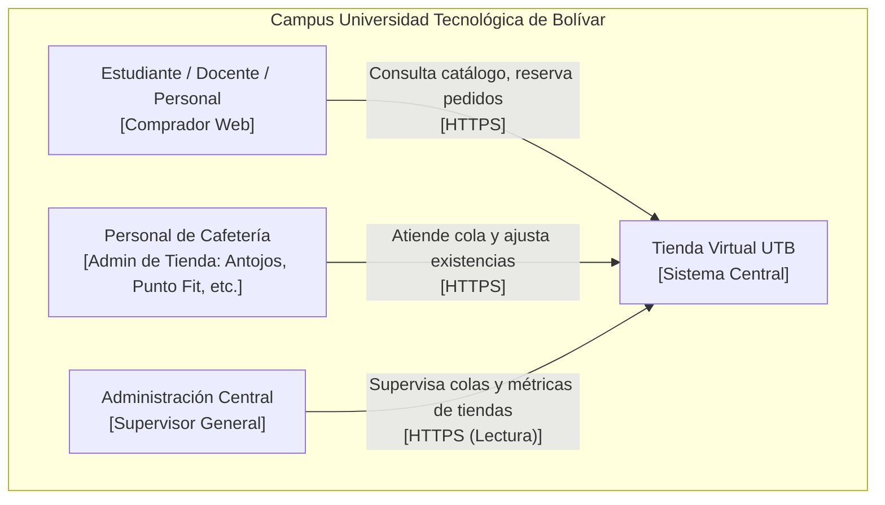
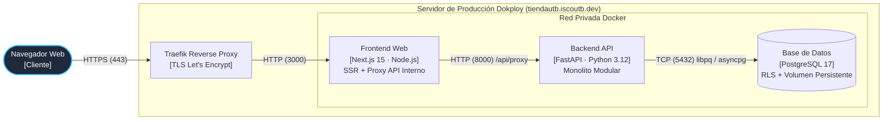
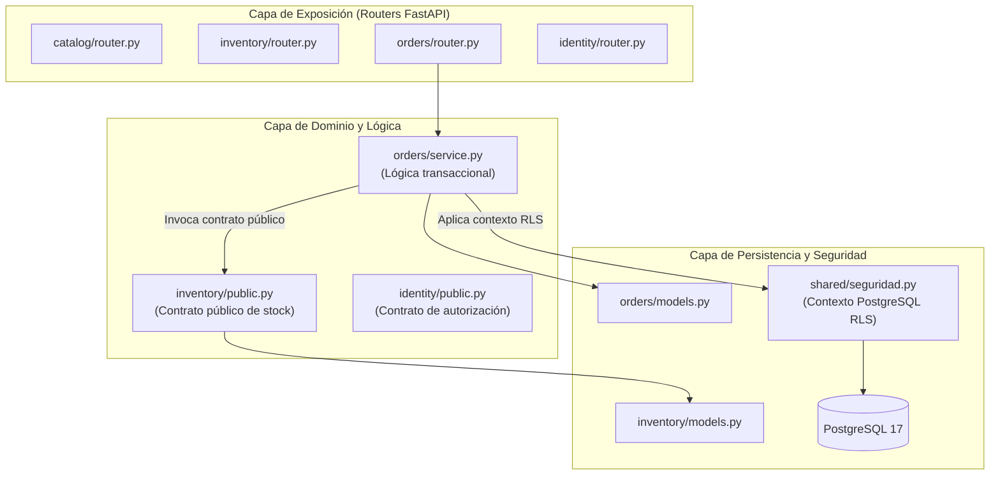

# Elemento 3: Vistas Arquitectónicas (Modelo C4 y Estándar arc42)

> **Alineación con la Rúbrica Oficial:** Sustenta el **Criterio 4 (Coherencia y trazabilidad arquitectónica — 0,75 pts)** al demostrar que el diseño estructural sigue estándares reconocidos de la industria y mantiene correspondencia exacta con el código desplegado.

---

## 1. El Modelo C4 de Simon Brown

Para comunicar la arquitectura a diferentes audiencias sin ambigüedades, utilizamos el modelo **C4**, que descompone el sistema en niveles progresivos de zoom:

### Nivel 1: Diagrama de Contexto del Sistema
Define las fronteras del sistema, los usuarios y los sistemas externos dentro del campus:

- **Frontera:** Todo ocurre dentro del ecosistema de las 5 tiendas del campus.
- **Punto clave:** No existe pasarela de pago bancaria externa. El pago ocurre en el mostrador físico.

---

### Nivel 2: Diagrama de Contenedores
Muestra las unidades de despliegue independientes y las tecnologías elegidas:

#### Decisiones de Contenedores:
- **Next.js 15 en modo SSR:** Renderiza páginas en servidor, oculta las URLs internas del backend y ofrece un proxy interno (`/api/proxy/`) que evita problemas de CORS.
- **FastAPI en contenedor Docker:** Expone la API REST modular documentada bajo OpenAPI 3.1.
- **PostgreSQL 17 en red aislada:** No expone puertos hacia Internet; solo el contenedor del backend tiene acceso mediante credenciales inyectadas por variables de entorno en Dokploy.

---

### Nivel 3: Diagrama de Componentes (Backend FastAPI)
Muestra la organización interna de los módulos y cómo interactúan respetando los Bounded Contexts:

---

## 2. Correspondencia con la Plantilla arc42 (12 Secciones)

El repositorio mantiene la documentación arquitectónica estructurada formalmente en `docs/arc42/arc42-template-EN.md` y `docs/arc42/11-riesgos-y-deuda-tecnica.md`:

| Sección arc42 | Contenido Documentado en el Repositorio | Archivo de Respaldo |
|---|---|---|
| **§1. Introducción y Metas** | Visión del sistema, 5 tiendas y stakeholders principales. | `docs/arc42/arc42-template-EN.md` |
| **§2. Restricciones de Arquitectura** | Stack tecnológico (FastAPI, Next.js, Postgres 17, Dokploy, dominio UTB). | `docs/arc42/arc42-template-EN.md` |
| **§3. Contexto y Alcance** | Límites del campus, interfaces de entrada/salida y contratos HTTP. | `docs/c4/context.md` |
| **§4. Estrategia de Solución** | Monolito modular, transacción compartida y RLS en base de datos. | `docs/adr/0001-monolito-modular.md` |
| **§5. Vista de Bloques (Estructura)** | Bounded Contexts y paquetes del backend con aislamiento AST. | `docs/c4/component.md`, `docs/bounded-contexts.md` |
| **§6. Vista de Ejecución (Runtime)** | Flujo de checkout transaccional y cancelación de reservas. | `docs/arc42/arc42-template-EN.md` |
| **§7. Vista de Despliegue** | Topología Dokploy, red Docker y certificados Let's Encrypt. | `docs/despliegue-dokploy.md`, `deploy/compose.lab.yaml` |
| **§8. Conceptos Transversales** | Seguridad JWT + RLS, observabilidad JSON, métricas y manejo de errores. | `backend/app/shared/` |
| **§9. Decisiones de Diseño (ADRs)** | Catálogo de 18 decisiones formales de arquitectura. | `docs/adr/` (ADR 0001 al 0018) |
| **§10. Requisitos de Calidad** | Escenarios AC-01 a AC-04 derivados del árbol de utilidad ATAM. | `docs/escenarios-calidad.md`, `docs/arbol-utilidad.md` |
| **§11. Riesgos y Deuda Técnica** | Clasificación de deudas: resueltas, asumidas y pendientes. | `docs/arc42/11-riesgos-y-deuda-tecnica.md` |
| **§12. Glosario** | Definición de términos de dominio del campus y cafeterías. | `docs/arc42/arc42-template-EN.md` |
