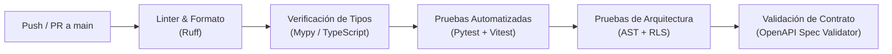

# Elemento 8: Despliegue, Operatividad, Riesgos y Deuda Técnica Asumida

> **Alineación con la Rúbrica Oficial:** Sustenta el **Criterio 5 (Demostración, sustentación y colaboración verificable — 1,00 pts)** al demostrar que el sistema opera en un entorno reproducible y que el equipo gestiona la deuda técnica con madurez profesional.

---

## 1. Topología de Despliegue en Dokploy

El sistema se encuentra desplegado y operativo en la infraestructura institucional de la asignatura:

- 🌐 **URL Pública:** [https://tiendautb.iscoutb.dev/](https://tiendautb.iscoutb.dev/)
- 🔒 **Certificado:** TLS wildcard emitido por Let's Encrypt con renovación automática.
- 📦 **Orquestación:** Dokploy consumiendo el archivo declarativo `deploy/compose.lab.yaml`.

### Arquitectura de Red en Producción
```
[ Internet ]
     │
     ▼  HTTPS (443)
[ Traefik Proxy Dokploy ]
     │
     ├─── HTTP (3000) ──► [ Contenedor Frontend Next.js 15 ]
     │                           │
     │                           ▼  HTTP (8000) /api/proxy/
     └─── HTTP (8000) ──► [ Contenedor Backend FastAPI ]
                                 │
                                 ▼  TCP (5432) Red Interna Docker
                          [ Contenedor PostgreSQL 17 ]
                          (Volumen persistente: tienda_pgdata)
```

### Propiedades Operativas:
1. **Red interna privada:** La base de datos PostgreSQL no mapea puertos al exterior. Solo los contenedores dentro de la red Docker pueden resolver su hostname.
2. **Inyección de secretos:** Variables críticas como `POSTGRES_PASSWORD`, `SECRET_KEY` y `API_URL` se configuran en el panel de variables de Dokploy, manteniéndose fuera del historial de Git (`.env` ignorado).

---

## 2. Pipeline de Integración Continua (GitHub Actions)

El repositorio cuenta con integración continua automatizada en `.github/workflows/tests.yml`:



Si cualquiera de estos pasos falla, la rama queda bloqueada y no se permite la integración en `main`.

---

## 3. Gestión de Riesgos y Deuda Técnica (arc42 Sección 11)

Un arquitecto profesional se distingue en que **no oculta las limitaciones de su sistema**, sino que las clasifica y gestiona de forma transparente. En `docs/arc42/11-riesgos-y-deuda-tecnica.md` clasificamos la deuda técnica en tres estados:

### 1. Deuda Resuelta (Fixed)
- **Migraciones de Base de Datos:** Se reemplazó el `Base.metadata.create_all()` inicial por migraciones versionadas y reproducibles con Alembic (ADR 0013).
- **Aislamiento Multitienda:** Se eliminó la dependencia exclusiva de filtros en Python activando PostgreSQL Row Level Security (ADR 0014).
- **Dominio Institucional:** Se superó el uso de URLs temporales `sslip.io` configurando el dominio oficial `tiendautb.iscoutb.dev` con certificado SSL válido.

### 2. Deuda Asumida Conscientemente (Assumed)
- **Unico Host Dokploy:** El sistema corre sobre una única máquina virtual. Si el servidor físico cae, el sistema se interrumpe. Esta decisión se asume conscientemente porque montar un clúster Kubernetes con alta disponibilidad añadiría costos mensuales injustificados para la escala actual del campus.
- **Medición en Loopback Local:** La medición de concurrencia de ~42 ms se ejecutó en la misma máquina. Se asume como un piso optimista; en la red pública se sumará la latencia del transporte TCP/TLS (~30-50 ms).

### 3. Deuda Pendiente (Pending)
- **Canal Formal de Hábeas Data:** La política de privacidad está documentada, pero el endpoint específico para solicitar la eliminación y rectificación de datos personales de compradores permanece en el backlog (`docs/pendientes.md`).
- **Drill Periódico de Restauración de Backups:** El volumen de PostgreSQL está nombrado y respaldado, pero aún no se ha ejecutado un simulacro automatizado de restauración desde cero en un entorno aislado.

---

## 4. Colaboración y Organización del Equipo por Áreas Técnicas

El desarrollo del sistema se organizó mediante especialización de responsabilidades entre los cuatro integrantes del equipo:

| Integrante | Áreas Principales de Responsabilidad Técnica |
|---|---|
| **Alejandro Patron Montero** | • **Backend:** Módulo de Identidad y seguridad.<br>• Implementación de políticas de Row Level Security (RLS) en PostgreSQL.<br>• Configuración de despliegue en Dokploy y validación de contratos OpenAPI. |
| **Jasen Mihovil Yukopila Escobar** | • **Frontend:** Arquitectura Next.js 15 en modo SSR.<br>• Sistema de tokens de diseño, filosofía de vidrio y maquetación editorial.<br>• Flujo interactivo del carrito de compras y pase digital. |
| **Levis Adrian Ortiz Cano** | • **Backend:** Módulo de Pedidos y transiciones de estado del ciclo de vida.<br>• Panel de administración para atención de colas en mostrador físico.<br>• Consistencia de existencias y documentación de cierre de proyecto. |
| **Shalom Jhoanna Arrieta Marrugo** | • **Frontend:** Construcción de componentes de UI, vitrinas de productos y layout.<br>• Pruebas automatizadas (Vitest en frontend y Pytest en backend).<br>• Auditoría de revisión arquitectónica entre pares de equipos externos. |
